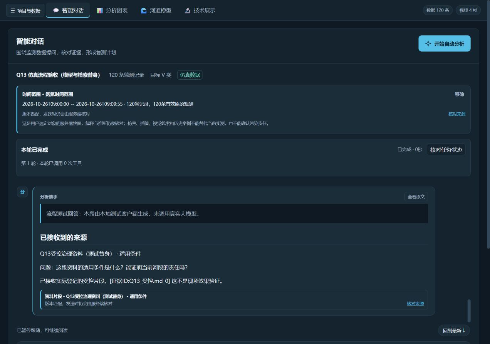
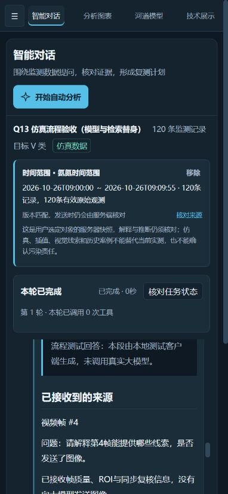

# Q13 选中对象精准追问验收

验收日期：2026-10-26。对应任务队列 Q13，基于 d5cabcc 开发。当前记录仅说明本项实现与实际验证，不把流程通过当成大模型回答准确或现场水质检测有效。

## 可用操作

| 来源 | 操作 | 实际传递内容 |
| --- | --- | --- |
| 地图采样点 | 点击色带，必要时切换附近记录，再点“让AI分析这个采样点” | 原始表格的行位置、时间、真实坐标（若有效）、指标与质控标记；同位置不合并不同记录 |
| 时间序列 | 拖动图表缩放条或填写起止时间，选择指标，再点“让AI分析这个时间范围” | 包含端点的时间窗；所选全部记录的有效原始观测统计、最多20条可核对示例；明确缺测/无效与插值 |
| 视频帧 | 选择已保存复核条件下的帧，点“让AI解释这帧的质量与线索” | 帧编号、视频版本、ROI、画面质量、人工复核和同步声明；没有向模型发送图像 |
| RAG资料片段 | 实际检索并展开原文，点“围绕这段资料提问” | 本会话实际返回的片段ID与原文快照；旧摘要或正文中的伪ID不授权引用 |

选择后进入主聊天，先显示可移除的来源卡和可编辑问题，保留已有问题草稿。用户显式发送后才调用Agent；选择本身不发送。用户和助手消息保留来源卡；“核对来源”由本地受控路由构造，回到图表、采样记录、指定视频帧或原文片段。

切换项目成功会清空待发卡与草稿；切换失败保留原内容。数据或分析版本更新后清除待发卡并保留问题。发送遇到过期引用时要求重新选择；重试不会悄悄丢掉原引用后改成无上下文提问。

## 数据与并发边界

- 新增 `POST /api/agent/context` 与 `GET /api/agent/context/{id}`。客户端只提交选择标识和项目/版本；服务器按真实会话数据读取坐标、数值、帧信息和登记原文。
- 创建、读取与聊天发送遵守既有会话操作锁。发送取得锁后重核项目、分析版本、结果版本、监测表内容指纹；视频还核对完整复核版本。验证失败不追加消息、不调用模型，并释放锁。
- 20个临时上下文和8次检索快照按会话限量保存。被淘汰、其他会话、恢复后的历史元数据不能授权新请求；旧卡片可以保留显示。项目包保存显示卡片，不保存临时授权表。
- RAG检索同样占用共享操作状态。项目、版本、查询或返回数量改变以及组件卸载后，迟到结果不会成为新条件下的引用入口。片段登记只接受结构化真实ID，冲突ID拒绝使用。
- 引文、仪器原文与说明作为待解释数据，与用户问题分开传入模型。保留既有引用校验和安全Markdown。该措施不能保证模型永不误解资料，不替代内容质量评测。
- 时间缺少时区时沿用监测表墙上时间，不追加虚构时区；带时区的时间按明确偏移转换，混合或不一致形式拒绝比较。插值不计作有效原始观测，0值保留。原始仪器字符串最多显示256字符并记录截断项。

## 实际验证结果

- 489项Python测试通过（本项新增24项），无失败、错误或跳过。覆盖四类来源、同坐标不同记录、缺GPS、0/无效/插值、完整时段统计及示例上限、显式时区、缓存淘汰、跨会话、表格原位变更、过期发送、锁释放、伪资料ID、视频替换和项目包保存恢复边界。
- 234项前端测试通过（较Q17阶段新增55项），核心类型检查和生产构建通过。新断言检查资料长标题及内容指纹格式后，14项真实Pinia上下文测试再次通过。两处既有SSR测试补齐新增组件依赖，保留旧断言。
- 字段名、前端字段、泛化与后端接口既有检查通过；密钥检查9项、实际后端响应契约导出16项通过。检查使用独立数据/项目/模型输出目录。
- 实际Vue生产构建连接真实FastAPI路由、上下文登记、Agent循环与SSE。浏览器逐项完成四类入口、显式发送、历史消息卡和来源返回；时间窗09:02—09:04包含25条记录，地图选中第61条并返回同条，视频选中第4帧并返回T+15秒，资料返回本次登记原文。检查移除卡片后问题保留。
- 1280、768、390、320宽度未发现页面横向溢出；上下文可换行、移除和来源入口可达。此处是桌面浏览器视口模拟，没有宣称真机、Safari、读屏器或全项目性能验收通过。

网页验收项目明确标注为“Q13 仿真流程验收（模型与检索替身）”：使用120条生成记录、4帧生成图案、明确标记的资料返回与本地模型客户端替身。服务器实际取数、锁、校验、聊天历史、引用检查与SSE均未替换；不把测试替身算成真实DeepSeek或真实向量检索评测。正式启动代码和生产构建不包含这些替身；临时预览脚本位于工作目录中。

机器可读记录：[question_context_acceptance_20261026.json](validation/question_context_acceptance_20261026.json)。

## 保留范围

本项提供精确来源追问，不完成Q14划词与侧边线程，也不完成Q15结构化建议或Q16工作台。新建的临时上下文在重启、恢复或淘汰后需重新选择；来源快照不自动转成当前实测或责任证据。没有新增在线模型质量评测、嵌入检索效果评测或现场检测准确率结论；视频仍为视觉辅助线索文本。

下一项按任务队列推进Q14；Q17整体验收仍待Q16后开展。
