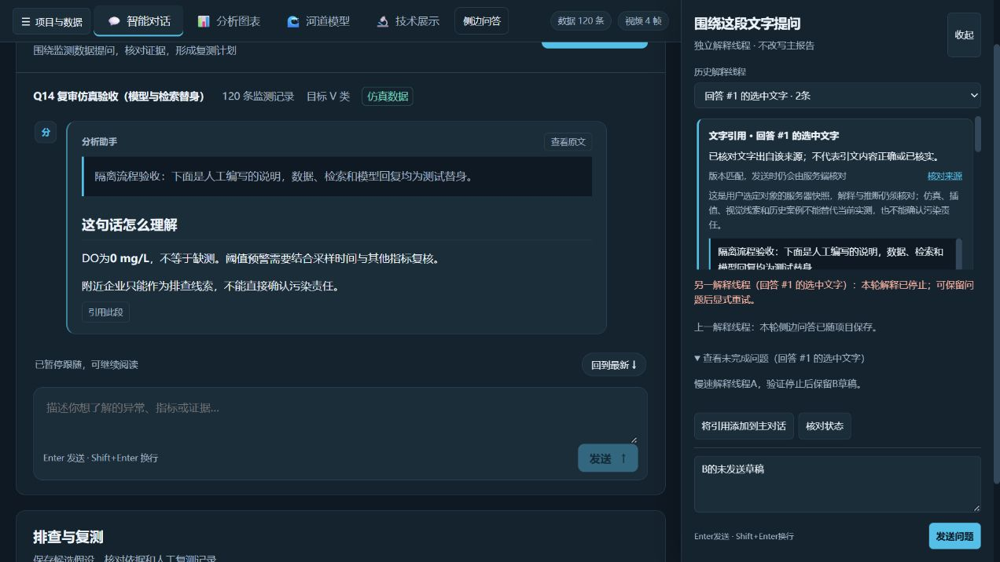

# Q13/Q14代码复审与修复

日期：2026-10-26。审查基线：`88f48b1f922b3185ab26e9c3cfda7dee22a7d649`。

本轮按用户要求暂停后续功能开发，检查选中对象追问、划词引用、独立侧边问答及项目保存恢复。通过先复现、再修复、再回归的方式处理了以下7类问题。Q15仍待开始；本记录不代替整个项目的全面安全审计、现场准确率验证或最终交付验收。

## 发现与修复

| 优先级 | 可复现的问题 | 修复结果 |
| --- | --- | --- |
| P1 | 已选择B后切到历史A，再选择同一B，界面可能仍使用A；准备线程的迟到响应也可能抢回用户已改选的线程 | 按文字、规范化来源和版本定位当前线程；异步准备同时检查项目、待选引用和当前线程是否变化 |
| P1 | 重新取得已有线程时覆盖其未发送草稿；准备请求期间继续编辑，发送后又把新内容清空 | 已有非空草稿优先；只清除实际提交且尚未改写的文字，保留后续编辑及其他线程草稿 |
| P1 | A流式解释期间改选B，A的增量、失败或保存提示可能出现在B下；失败问题还可能被后续编辑遮蔽 | 增量按线程显示，事件核对线程和任务ID；跨线程状态明确说明归属，未完成问题可展开查看，不能覆盖新草稿 |
| P2 | 主对话将所有409都视为来源失效，任务忙碌时也移除有效引用 | 后端忙碌冲突返回`X-Session-Conflict: busy`，前端保留引用和原问题；实际来源失效仍要求重新选择 |
| P2 | 导入侧边消息时接受列表等异常`run_id`及字符串`incomplete`，后续历史组装可能报错或误判完整性 | 项目消息严格校验允许字段、32位十六进制任务ID及布尔完整性标记，实际项目编解码回归覆盖异常输入 |
| P2 | 缺少模型密钥且没有产生问答记录，仍提示本轮已保存；初始化异常可能未正常进入工作线程收尾 | 初始化纳入异常处理，向客户端返回失败事件并释放锁；无新增记录时不自动保存、不宣称草稿已写入项目 |
| P2 | A/B消息按数组下标复用组件，Markdown限频排版让上一线程回答短暂显示在新线程引用下 | 消息渲染标识包含线程ID，切换线程立即创建对应内容；保留同一回答流式排版的限频策略 |

第7项由实际浏览器切换发现。稳定后的保存内容属于正确线程，异常发生在切换瞬间的旧排版显示。新增测试挂载真实`SideQuestions.vue`和`SafeMarkdown.vue`，冻结计时器后检查切换下一次Vue更新时的内容，修复前失败、修复后通过。

## 验证结果

- Python完整回归510项：0失败、0错误、0跳过。新增4项后端回归覆盖项目消息字段、缺密钥、初始化失败和忙碌响应。
- 前端完整回归253项：全部通过。较Q14初验新增10项，覆盖选区/线程归属、迟到准备、草稿保护、后台增量/失败/保存提示、忙碌冲突及真实组件切换排版。
- TypeScript类型检查、Vue生产构建通过；字段一致性、泛化、后端接口、密钥泄漏检查及16份前端响应契约导出通过。
- `git diff --check`通过；仅提交审查相关源码、回归测试和本记录。

完整回归使用项目当前源码和本机已配置的依赖，在独立项目库、临时目录、RAG及地形缓存中运行。本轮没有重新进行干净机器依赖安装或GitHub远端CI验收。

## 实际浏览器回归

使用`127.0.0.1:5187`隔离服务、真实FastAPI路由/上下文核对/工作线程/SSE和Vue生产构建。120条数据为生成仿真记录，4帧为生成图案；模型和检索明确使用本地测试替身。本轮没有新增真实大模型、向量检索效果或现场检测精度结论。

实际操作验证：

1. 原生双击选择`mg`建立线程A；使用“引用此段”选择整段报告建立线程B，两者分别解释并保存。
2. 在B填写未发送草稿，切到历史A，再选择同一B，正确恢复B的引用、回答和草稿。
3. 加载修复后生产构建，A/B切换立即显示各自回答，没有上一线程排版残留。
4. A慢速流运行期间改选B，B只显示自己的历史，保留其草稿；A完成后的保存提示注明属于上一解释线程。
5. 再次运行A并在B界面停止，停止提示注明属于另一解释线程；B草稿仍在，A的未完成问题可展开查看。
6. 主报告仍是原人工编写说明，未被侧边回复替换；当前桌面页面无横向溢出，验收页控制台没有捕获到错误。

本轮浏览器只复测上述桌面流程，未新增手机真机、Safari、读屏器或独立设计评审；Q14初验的其他视口记录保留原时间和范围，不作为本轮新结果。浏览器中的草稿是会话内未发送内容，本轮没有新增刷新后持久化草稿能力。

机器记录：[q14_review_20261026.json](validation/q14_review_20261026.json)。历史初验：[Q14划词引用与侧边问答验收](Q14划词引用与侧边问答验收.md)。
