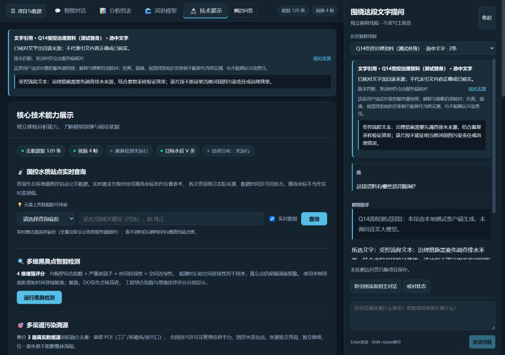
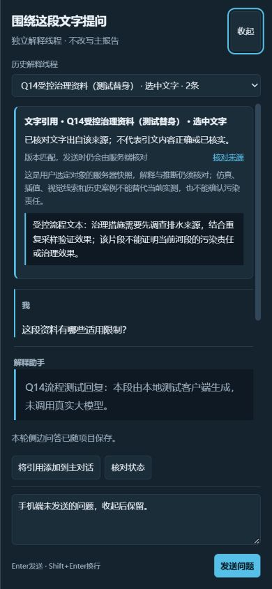

# Q14 划词引用与侧边问答验收

日期：2026-10-26。基于 ba9f92c 开发；对应任务队列Q14，复用Q13的服务端来源核对和现有安全Markdown、SSE、会话操作锁。

## 已实现的使用方式

在主回答/报告、实际RAG返回的原文、技术展示的资料检索说明中选中文字，浮动菜单提供“添加到对话”和“在侧边聊天中提问”。选区须在同一个显式文本来源中，支持同来源跨行、跨段；不采集表单、密钥、隐藏DOM或整个页面。键盘选择后可按Alt+Q聚焦菜单，Esc取消；“引用此段”是键盘与触屏的等效入口。超过3000字会要求缩短选择，不静默截断。

- 添加到对话：先显示可移除的原文卡，保留主问题草稿，不自动发模型请求。显式发送时由服务端重取并核对来源；服务器返回核对卡后才进入既有主Agent流程。既有数据、时段、视频和RAG整段追问继续可用。
- 侧边提问：打开独立解释线程与独立输入框。可连续追问、停止、收起/重开、选择已保存线程，也可显式将引用转入主对话。主问题和侧边问题相互独立；解释线程不写主报告或排查板，不更改主Agent任务及分析完成状态。
- 桌面采用右侧问答区，打开时收起项目栏，避免左右同时挤压。窄屏采用有背景隔离、焦点循环与Esc关闭/焦点恢复的抽屉。原文、历史回答及未完成输出可按实际状态阅读。
- 来源链接返回对应回答、页面说明或当时所选的RAG原文快照。选中文字在卡片中可直接阅读；长引用局部滚动。历史RAG快照不冒充新检索结果或完整原始发布内容。

首批可划词的页面说明是技术展示中的资料检索说明；不声称所有页面的任意文字都已纳入来源登记。主报告中的复制、表单输入与地图拖动不被菜单接管。

## 来源、线程与保存边界

主回答由服务器按位置、角色、任务与原文生成来源指纹；同文不同回答不会混成同一来源。后端采用与前端同族的Markdown解析器核对渲染后的可见文字，保留代码、表格、中文和0值的语义文本；不执行HTML或读取引文中的链接。复杂格式不匹配时明确拒绝，可在原文视图重新选取，不猜改引文。

RAG引用只来自本会话登记的真实返回片段；页面说明来自服务端固定说明。引用正文、来源与问题分开传递。出处匹配只证明文字出自该位置，不证明原回答、案例或说明内容正确，更不将其当作新观测或工具指令。

侧边问答提供`/api/side/threads`、逐线程SSE、任务状态和停止接口，没有工具调用面。只给模型所选文字、必要来源和本线程近期完整对话；不默认附带整页、主报告全文或主线程历史。历史上下文最多20条、2万字符，已保存历史仍可查看。单项目最多20个线程，每线程最多60条消息，超限明确提示，不自动丢弃历史。

显式发送后，绑定项目的线程会自动随项目保存；临时会话提示手动保存。磁盘或版本冲突时保留当前内存记录并提示保存失败，不声称已落盘。未发送的主/侧边草稿仅在当前浏览器工作区保留，关闭面板或切换页面不丢；刷新页面、成功切换项目会清空待发草稿。切换项目失败保留原内容。

项目包升级为schema 3，可读取schema 1/2，旧包以空侧边线程迁移。保存的是来源卡和正式问答，不保存网络流、锁和线程对象。旧版应用不能读取schema 3包；回退应用前应保留原版本项目备份。恢复项目或更换数据后，旧引用按历史显示，发送前要求重新选择；历史文本不自行授权当前事实。所有操作遵守原有全局互斥；停止等待调用收尾后才释放锁。

## 验证结果

- 506项Python测试通过，0失败/错误/跳过；本项新增17项，覆盖精确片段、跨段Markdown、伪造/超长/错来源、同文不同来源、独立历史、无工具、重复请求、过期与忙碌、错误引用、schema迁移、保存恢复、恶意元数据、停止持锁和磁盘失败。
- 243项前端测试、核心类型检查和生产构建通过。本项新增9项真实Pinia/选区边界回归；既有SSR用例补齐新增引用组件所需Pinia，保留原有断言。
- 字段名、前端字段、泛化、后端接口及密钥9项检查通过；既有实际响应契约16项导出通过。直接fetch保留会话头，检查规则未放宽。
- 真实Vue生产页连接真实FastAPI与侧边SSE。原生双击划词与Alt+Q菜单、加入主对话和草稿保留、侧边连续问答/停止、页面说明和RAG原文等效引用、来源返回、关闭重开与项目切换均实际操作验证。
- 独立Python进程从隔离项目库恢复3个线程，消息数4/2/2，主消息仍为3条，主分析状态仍为idle。浏览器新建空项目后引用、线程和草稿清空；重新打开原项目后恢复历史线程，旧引用发送被阻止。
- 1280、768、390、320宽度未见页面横向溢出；窄屏实测背景inert、Tab循环、Esc关闭后焦点回到入口，未发送的手机草稿保留。该检查为桌面浏览器视口模拟，未测物理触屏、Safari或读屏器。

隔离项目为“Q14 仿真流程验收（模型与检索替身）”，使用120条生成数据、4帧生成图案、受控资料返回及本地模型客户端。实际服务器取源、线程、锁、SSE、引用检查与保存流程没有替换；没有新增真实DeepSeek质量、真实向量检索效果或现场准确率结论。临时测试客户端不进入生产源码。截图采用自查，未组织独立视觉评审；本项不代表Q17整体验收或性能画像完成。

机器记录：[text_questions_acceptance_20261026.json](validation/text_questions_acceptance_20261026.json)。

用于可见Markdown来源核对的依赖：[markdown-it-py 4.0.0](https://pypi.org/project/markdown-it-py/4.0.0/)，已同步至普通、锁定和CI依赖清单。

下一项是Q15结构化分析卡片与建议操作；Q16、Q17整体验收与Q11最终材料仍待完成。
