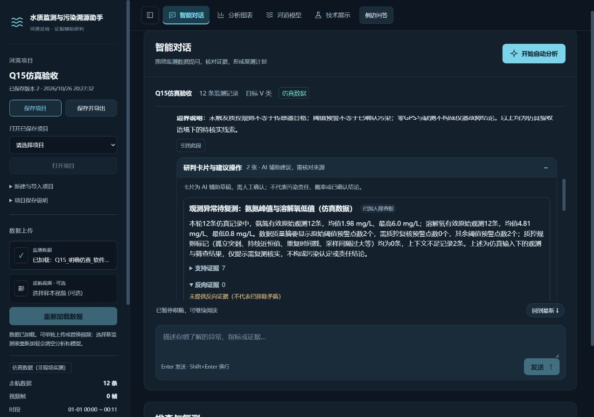
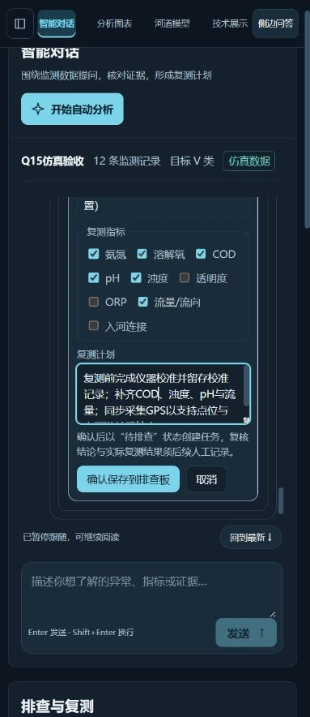

# Q15 结构化研判卡片与建议操作验收

日期：2026-10-26。本项完成软件实现与受控验收；不表示现场准确率、污染责任或物理反演效果已经验证。代码写入 E 盘当前项目。

## 已实现的使用流程

完成的助手回答如带本轮证据，可展开“研判卡片与建议操作”，按需加载至多5张卡片。卡片展示发现、支持与反向证据、缺口及候选复测建议；支持引用默认折叠，反向证据未提供时明确显示，不能将空列表解释为已排除其他成因。原报告和整轮工具证据保留。

统计引用可查看关联原始行，记录引用可进入图表/地图核对，工具和RAG引用可展开实际快照，视频引用通过现有帧上下文接口返回视频证据。无GPS时只展示记录并说明无法定位；不补造坐标。RAG为历史参考，视频质量线索不能替代水质实测。

点击“生成复测草稿”仅取得可编辑的标题、假设、支持/反向笔记、位置说明、指标与计划。取消不写入任务；只有用户点击“确认保存到排查板”才创建待排查任务。经纬度由已核对的原始记录读取，不能由模型填写；有多个引用点位时不随意选第一个点，没有唯一关联记录则保持坐标为空。人工复核与实际复测结果保持空白。已保存任务带AI辅助、用户确认来源，可在现有排查板后续编辑；重启后仍能恢复任务及卡片的已确认标记。

## 证据与保存约束

新增两项Function Calling工具：`get_analysis_card_catalog`、`submit_analysis_cards`。前者只提供本轮成功且未截断的工具证据目录，后者只提交候选，不具有任务写入权限。目录令牌绑定数据/分析指纹和实际工具轨迹，最终完整回答保存前再次校验；失败、停止、部分完成不挂载可操作卡片。旧回答不会通过解析Markdown补造卡片。

新增读取、预览与确认HTTP接口。预览绑定当前会话、项目、证据、卡片内容及排查板版本，最多20条、有效期5分钟。确认使用请求UUID、规范化草稿摘要和持久化来源防止重复写入；不同内容复用请求、旧版本、过期预览、来源损坏和重复来源均拒绝。保存失败回滚排查板并保留可重试预览。临时会话只提示加入内存排查板，须显式保存项目后才能重启恢复。

前端懒加载、局部展开和确认均有异步版本保护；旧项目的成功/失败响应不能覆盖新选择。同项目分析更新时保留编辑草稿并禁止旧版本保存。支持列表、表单和内联快照使用纯文本，不能执行模型返回的HTML或任意链接。记录跳转核对当前证据ID和行号。

## DeepSeek协作开发与审查

研发采用独立、并行的DeepSeek API上下文，分工产出后端、保存流程、前端与回归测试草稿，再由主代理审查、整合和实际执行。开发上下文没有本机文件修改或命令执行工具，输出先保存在独立待审目录；不是把多个模型直接写入产品工作流。

实际调用模型ID为`deepseek-flash`及独立审查的`deepseek-v4-pro`。选择依据为[官方更新记录](https://api-docs.deepseek.com/updates/)和实际`/models`可用列表；Flash使用当前官方新版本路径，Pro作交叉审查，不将型号名称当作质量保证。开发任务使用high/max思考配置；原Web运行时迁移到当前Flash别名并显式保持非思考工具协议，以兼容现有流式工具历史。开发和产品调用模式分别记录。

初批大任务发生输出截断，未应用；拆分后的后端与测试草稿完成。另有两份完整JSON因路径/额外文件超出初始白名单被接收器拒绝，主代理逐文件阅读并对齐路径、接口、边界和测试夹具后才整合，没有直接放行。独立Pro审查的三项来源/目录加固已采纳；“目录工具必然改变令牌”的意见被实际白名单捕获逻辑、真实工具回合与集成测试反证；扩大忽略所有外部失败的建议与既有Q07边界不符，未采用。

主代理另外发现并修复了实际视频版本与追问参数不匹配，以及首次证据行请求已返回但Vue页面仍显示加载的问题。后者通过浏览器发现，再补真实模板重渲染回归，未以状态断言替代页面验证。密钥只在本机进程中读取并用于官方HTTPS授权，未加入提示、代码、日志产物或Git；开发提示未包含原始Excel、视频或用户项目数据。

详细模型任务、可取得的usage计数、失败接收情况和审查裁决见[机器验收记录](validation/q15_analysis_cards_20261026.json)。最早截断请求未保存usage字段，因此总耗用不作估算；记录中的known计数只包含可核实的返回值。

## 实际验证

- 完整Python回归534项通过，保留原有检查；最新相关集成45项另行通过。前端280项通过，类型检查、生产构建、19份实际HTTP响应类型赋值、1个TypeScript组件脚本的严格检查及9项密钥检查通过。
- 真实DeepSeek API两次完成12行明确仿真数据的摘要→目录→提交，每次取得2张卡片；未使用预制模型回复。此项只验证卡片工具链，没有重测在线RAG、站点接口或原始巡航样本的现场效果。
- 真实隔离FastAPI与Vue生产构建，通过页面导入该仿真项目。预览、取消保持排查板为空；修改标题后确认，仅创建1项待排查任务，复核/实际复测为空；服务重启后恢复项目v2、1项任务和已确认标记。未改写用户正式项目或正式服务。
- 浏览器首次展开极值证据实际显示记录#7、氨氮6.0 mg/L和DO0.8 mg/L，退出加载；记录跳转实际显示记录#1、氨氮0.4 mg/L、DO7 mg/L，并明确无GPS无法地图定位。
- 320/390/768/1280四种宽度，卡片与表单均无横向溢出；窄屏指标复选、计划编辑、确认/取消可操作。仅为本机视口模拟，未测试真实移动设备、Safari或读屏器。本轮视觉为主代理自查，未宣称独立审美评分或性能提速。

## 保留边界与下一项

结构化引用验证对象存在、归属与时效，不能证明模型推断的语义和因果关系成立。建议仍为候选，需要人工核对、校准与现场复测；本轮没有新增污染识别准确率或责任结论。Q16下一步整合协同研判主入口，随后继续Q17全流程性能与体验验收及Q11最终参赛材料。
