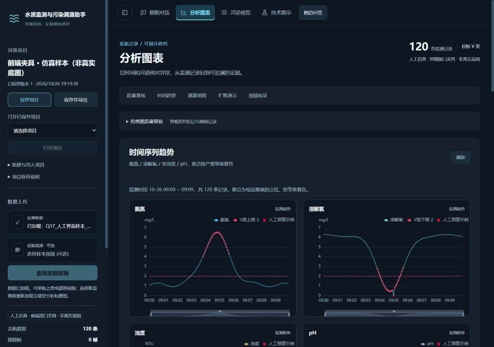
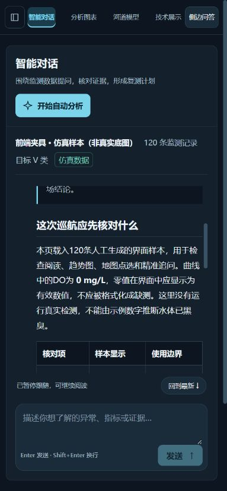

# Q17 全站视觉细化阶段验收

日期：2026-10-26。基线提交：`ba3354295d61380ce115972ff2d1c4461dc226ec`。按用户要求提前继续Q17的界面美化；Q15、Q16没有在本轮开始开发。Q17的完整性能画像及Q16整合后验收仍待后续，本记录只确认本轮视觉细化及列出的前端回归。

## 设计与实现

使用用户提供的[distinctive-ai-design skill](<D:/哔哩哔哩/微信/微信聊天记录/xwechat_files/wxid_kezc6pis5p2l22_0a04/msg/file/2026-10/distinctive-ai-design-main/distinctive-ai-design-main/SKILL.md>)及其评审参考，继续既定“河道研判工作台”方向。面向巡检人员、分析人员与评委，以深蓝灰和青蓝交互色突出项目、问题、证据与下一步动作；不用装饰图片或远程字体。

- 统一四页导航的线性SVG图标、激活态、文字与控件层级；整合背景、边界、圆角及焦点样式。沿用污染等级的既有五种颜色，图表底色改为融入工作区的透明背景，未更改曲线值或污染色标。
- 项目保存和打开保持常显，新建、另存、导入及长说明收进原生折叠区；数据上传前移，外部服务配置按需展开。现有操作和状态仍可访问。
- 对话中减少报告外层重复卡框。报告区拥有滚动空间，输入与发送区随视口分配高度；低频的排查板仍按原有机制展开。
- 图表页增加当前数据摘要与内容目录；质量复核默认折叠，展开后仍可看阈值、质控标记和记录。趋势图前移，时间范围追问表单放到图表后。
- 河道页按参数来源、配置与水动力、污染情景组织导航和表单；技术页增加七项目录、编号及实际适用条件标签，保留原有模型边界和验证依据。
- 引用卡突出原文、来源和版本，较长通用边界按需展开。侧边问答整理线程、消息及输入区；桌面仍为400px，与应用预留宽度匹配。
- 成功/失败提示移到上方并避免拦截鼠标，手机提示不再盖住输入区。跨页导航回到页首，目录定位保留顶栏偏移，浏览器历史仍使用保存的位置。

本轮未更改水质筛查、地图坐标/热力算法、物理模型、API、项目格式或真实数据。增加的UI状态修复包括：焦点循环纳入原生summary；已结束或历史已返回的解释不再重复标为“正在解释”。后者先用行为测试复现失败，再修复通过。

## 截图评审与修正

首轮使用新的独立设计评审上下文，仅提供截图、用户任务和设计brief，没有提供源码、历史评分或目标分数。主观完成度为7.5/10；三个重点是导航状态、研判内容的首屏优先级、手机输入与提示竞争空间。

据此修正：激活态即时切换、趋势图前移和质量复核折叠、输入区自适应及提示位置。随后实际浏览器检查并进行第二轮自查；第二轮没有新增独立评审者。自查确认上述三项得到改善，仍保留辅助文字偏小、手机长报告须在报告区滚动等取舍。审美判断不作为性能或业务验收证据。

[桌面对话](assets/q17-ui-phase2-chat-desktop-20261026.jpg) · [河道模型表单](assets/q17-ui-phase2-river-desktop-20261026.jpg) · [技术展示](assets/q17-ui-phase2-tech-desktop-20261026.jpg) · [手机侧边问答](assets/q17-ui-phase2-side-mobile-20261026.jpg)

## 实际回归

- 254项前端测试全部通过，包含新增的停止/历史回传后不重复显示增量的回归。类型检查、生产构建、9项密钥检查及Git差异空白检查通过。本轮没有修改后端源码，也没有重新计入此前510项Python通过记录。
- 实际Vue生产页在320×740、390×844、768×900、1280×900四种视口检查四页，共16项：未见页面横向溢出，各页仅一个当前导航。聊天输入区下沿分别约705、809、855、849px，均在对应视口内。
- 手机项目抽屉中，V按钮后的Tab可到达外部服务折叠标题；Enter可展开，Tab循环回关闭按钮，Escape关闭并恢复焦点。主区保持inert隔离。
- 原生双击选中mg，出现划词菜单；加入主对话后原问题草稿保留，引用可移除。侧边问答关闭重开、解释停止、原问题保留及手机发送区可达通过；停止后的“正在解释”数量为0。
- 质量复核可展开；图表时间范围可进入主聊天上下文卡。目录锚点约保留84px顶栏空间，从资料目录深处切回对话后页首位置为0。
- 地图可显示点位弹窗的时间和指标，图层开关、全屏及退出可操作；退出后恢复页面滚动。地图在本轮使用本地示意网格，不是卫星底图接入或坐标精度验收。
- 最终验收页没有捕获到error级控制台日志。测试数据与界面状态覆盖范围见[机器记录](validation/ui_phase2_20261026.json)。

## 验证环境与保留范围

此前Python依赖目录被系统拒绝读取，额外读取授权后仍失败。本轮采用独立Node接口夹具服务生产前端，使用120条人工记录、人工报告、模拟SSE/状态和本地示意瓦片。星图能力位为夹具模拟，不读取实际密钥或访问真实地图、站点、模型、检索服务；项目操作仅驻内存或明确提示未执行。截图和页面保留了这些身份说明。

因此，本轮不声称真实Agent/后端联调、模型推理质量、向量检索效果、地理校准或现场检测准确率通过。未测试手机真机、Safari、读屏器或低端设备；没有完整长任务/输入延迟性能画像，不给出提速比例或帧率保证。正式项目库、原始样本和本机配置未参与夹具操作。

Q17后续仍需完成地图/扩散/长报告的同数据性能对比，以及Q15—Q16整合后的整体验收；本轮不将这些待办标为完成。
