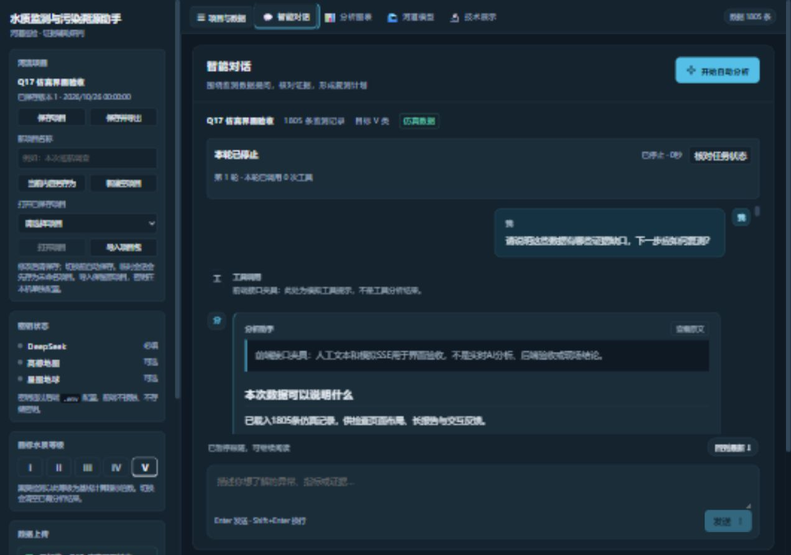
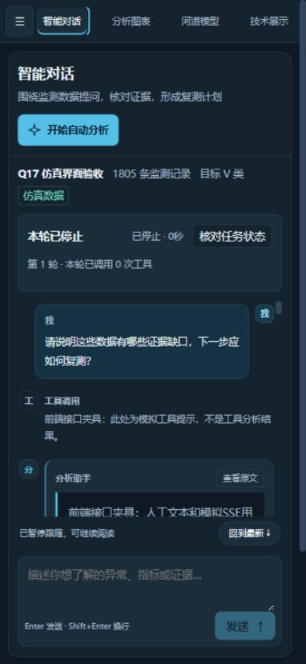

# Q17 前端基线与代表页阶段验收

日期：2026-10-26。范围为对话/报告代表页、阅读跟随和共享视觉样式。Q17整体仍进行中，Q13—Q16未实现；本阶段不构成真实AI效果、现场准确率或完整后端联调验收。

## 已实现

- 统一对话/报告的文字、按钮、间距和圆角；主界面使用项目名、记录数、目标等级和仿真身份展示当前上下文。产品入口改用任务描述，技术框架仍在技术展示与文档说明。
- 输入区支持多行；Enter发送、Shift+Enter换行，输入法合成状态不误发送；忙碌、加载、无数据或未连接时保留草稿并阻止发送。
- 自动滚动按动画帧合并；上读、触摸/指针阅读意图或聊天内选区出现时暂停。新内容提示位于独立阅读控制条，不覆盖正文；用户可显式回到最新。
- 排查板按需首次挂载，关闭后继续保留已挂载内容与草稿。报告加入任务时自动展开，按项目/工作区和任务版本核对后定位，切换项目的迟到定位作废。
- 1023px及以下使用项目抽屉；核对四种宽度，改进平板中侧栏挤压主区的问题。目标等级使用中性边框表示选中态，未改污染色标、坐标、指标或数值算法。

## 验证与实际范围

179项前端测试通过，含原154项、11项滚动控制器行为和14项真实Vue setup行为检查；既有strict/checkJs范围新增滚动工具，类型检查和生产构建通过。没有声称所有Vue组件已完全类型化。

14项setup检查覆盖输入法、Shift/普通Enter、发送门禁、选区范围、卸载、折叠与草稿保留、任务自动展开、同ID新revision，以及两次nextTick之间切换项目。其HTTP与子组件受控，不作为真实浏览器或后端验收。

浏览器实际加载生产Vue产物，使用隔离的Node接口夹具回放人工文本与模拟SSE；1805为夹具声明的仿真记录数，未运行水质检测、真实大模型或外部资料查询。数据身份和说明保留在页面上。

| 检查 | 结果 |
| --- | --- |
| 320×740 / 390×844 / 768×900 / 1280×900 | 页面无横向溢出，本次夹具状态的输入区下沿均在视口内；精确数值见JSON |
| 持续流式更新后上读 | 字符数15840→16431、滚动内容高度15735→16289px；上读位置始终0px |
| 回到最新 | 与内容底部间距0px，跟随提示恢复 |
| 停止回放 | 页面可见“本轮已停止”；这是前端夹具回放 |
| 换行与草稿 | Shift+Enter保留换行；排查板关闭重开后主聊天与排查标题草稿均保留 |
| 最终浏览器控制台 | 本次最终页面未记录error级日志 |

现有代码在上传前另完成465项Python回归及原有离线门禁；本阶段没有改后端源码，未将该旧检查重复计作新的后端联调。

## 真实截图与设计评审

按用户提供的distinctive-ai-design进行两轮独立截图评审。首轮重点修正手机输入区落到屏幕下方、返回按钮遮正文和等级选中态混淆；第二轮保留手机长报告连续阅读空间、侧栏层级和辅助文字对比问题，后续整体验收继续处理。主观审美评价与交互/性能证据分别记录。

## 尚未完成与环境限制

- 本轮无法重启完整Python预览：现有依赖文件在额外读取授权后仍被系统拒绝读取。后台常驻启动也被自动审批拒绝，采用受控的前端夹具会话完成UI检查；正式项目及原始文件未参与本轮接口夹具。
- 尚无真机触屏、Safari、读屏器、低端硬件或完整浏览器长任务/输入延迟画像，不给出跨设备提速比例或帧率保证。
- 阅读跟随保护不等于流式Markdown的DOM选区完全稳定，Q14仍需完成引用快照、来源绑定和实际选区验收。
- 地图对象复用、扩散播放性能、全站控件覆盖及Q13—Q16整合后的Q17验收尚待完成。

下一项为Q13选中对象的上下文精准追问；完成Q13—Q16后回到Q17整体验收，再完成Q11最终演示与材料同步。

机器记录：[ui_phase1_20261026.json](validation/ui_phase1_20261026.json)。
