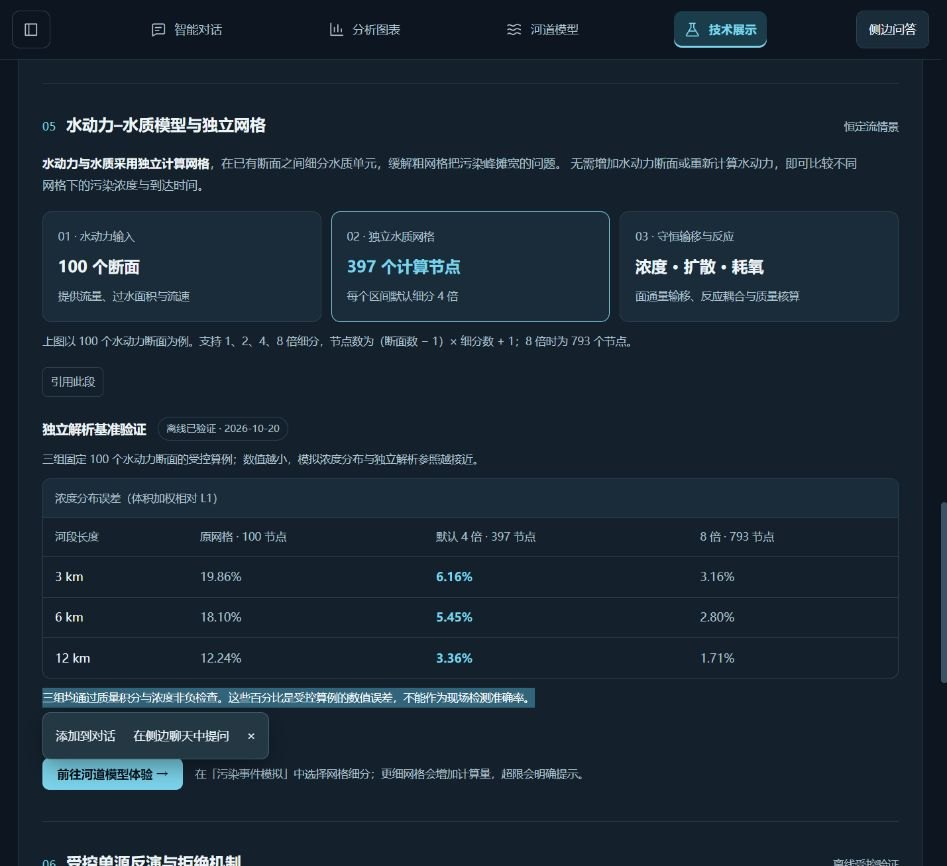
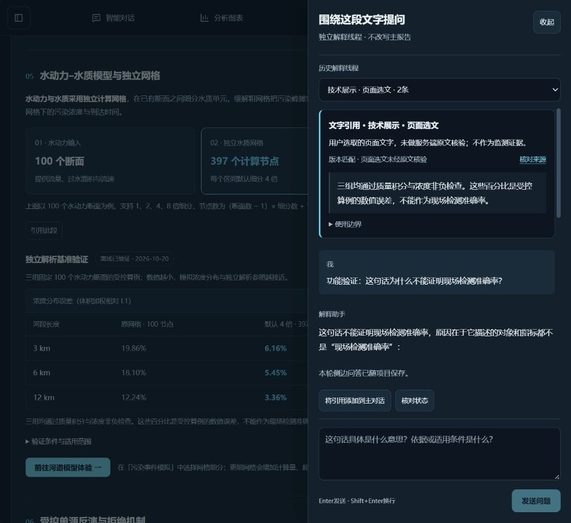

# 全站划词引用与精准提问验收

日期：2026-10-27。按用户要求，将划词入口从少数注册段落扩展到四个页面的可见、可选择文字，包括普通说明、标题、HTML表格、结果卡及独立解释文字；无需逐段新增组件。输入框、可编辑区、隐藏/不可交互区与应用外文字排除；跨表单选区也不采集编辑内容。像素绘制的图表、图片和视频不是原生文字，不将本功能宣称为OCR。最多3000字，超限提示缩小选区，不静默截断或上传整页。

## 来源与解释边界

已注册的回答、RAG原文和帮助说明继续使用现有原文校验。其他选区使用新增`page`来源，只记录选中文字、应用内页面和区域锚点；前后端均明确显示“页面选文未经原文核验”。服务端核对项目、监测/结果版本和允许的路径，无法据此验证浏览器DOM原文；不将这种选文放入监测事实或可引用证据目录，不冒称已核实数据。主聊天和独立侧边问答仍由用户显式发送，原有草稿、线程隔离、停止与保存机制保留。

客户端从真实选区读取文字；保留精确来源优先，跨来源选区按普通页面选文解释，不能冒用其中某个回答或资料ID。页面跳转后移除的节点不再接受，隐藏菜单时取消待处理的取选区回调。返回来源按允许页面和安全锚点重建，导入的任意外部URL不被执行；未注册页面选文定位到区域，不宣称可复原瞬时地图弹窗或精确字符偏移。

## 真实验证

- 546项Python、324项前端、类型检查（含现有1个SFC脚本严格检查）、生产构建，以及字段/泛化/接口/密钥/HTTP类型样本门禁通过。前端新增9项全局选区回归，后端新增4项页面引用与隔离/保存测试。
- 真实浏览器依次在技术展示、智能对话、分析图表、河道模型的普通标题上鼠标双击，四页均出现“添加到对话 / 在侧边聊天中提问”。
- 从河道模型选文进入主聊天，展示页面来源和未核验提示；没有发送测试主问题，随后移除测试引用并恢复原来的空草稿。
- 选中此前未注册的基准说明，实际发起标注“功能验证”的侧边问题。真实DeepSeek返回解释，页面显示问答已随项目保存，主报告保持独立。输入框内全选测试文字没有弹出划词菜单，测试后清空测试草稿。
- “核对来源”实际返回技术展示对应区域，显示版本与原文核验状态。重启前项目“111”保存为v6并导出；1805条记录、147帧及历史报告保留。最终在线侧边问答是实际调用；其他自动化中的模型替身仅检验协议与隔离。

独立DeepSeek Pro审查后主代理采纳节点连接检查与回调取消建议。未采纳“用浏览器哈希证明DOM原文”的建议：该哈希不能证明前端文本，且本功能有意将其标为用户提供材料；未引入整页上传。关于Shadow DOM，当前应用未使用此机制，隔离内容也无法通过同树app祖先检查，未增加遍历。最终处理决定由主代理核查，未自动应用审查模型输出。

本次没有新增检测准确率、反演精度或多模态模型能力；Q16、Q17剩余整合与性能验收、Q18业务接入的既有状态不因此改变。
