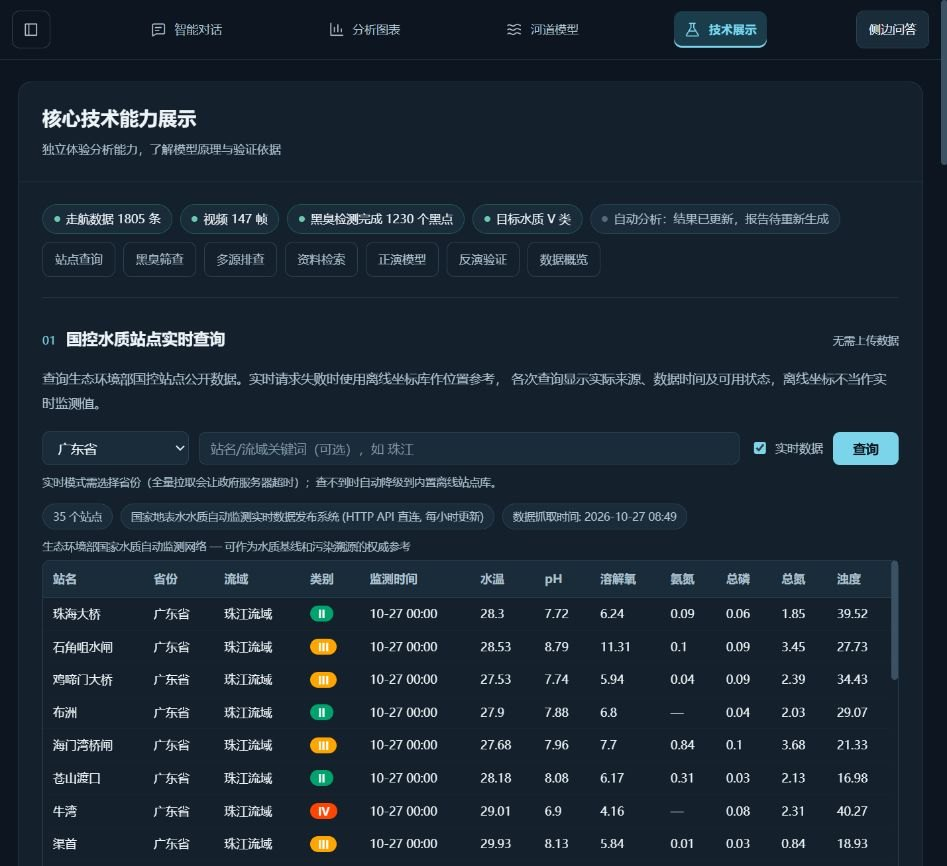

# 国控站点查询结果消失修复

日期：2026-10-27；项目：`E:/E-Desktop/传智杯-备赛`。

实际复现：广东省实时查询的后端日志已返回35条记录，前端按钮结束忙碌但没有任何结果或错误。原因是`StationQuery`监听函数每次返回一个新数组；查询成功后`refreshStatus()`替换状态对象，即使项目ID和监测版本没变，Vue仍认为监听值改变，递增请求版本并清空结果，使自身成功响应被当成过期响应丢弃。

将站点查询、多渠道溯源和统计卡片的相关监听改为独立标量来源。普通状态对象更新保留查询结果；真正改变项目、工作区、监测版本或查询条件，仍撤销旧响应。统计卡片也不再因无关结果状态更新重复加载。增加局部查询进度与可读的结果状态，以及省份/关键词的无障碍标签。未修改数据来源、后端算法或报告失效规则。

先增加6项回归：修复前该专项21项中4项失败，覆盖自身状态刷新、同作用域对象替换和统计重复加载；另外两项确认实际监测版本变化仍拒绝旧响应。修复后314项前端测试、类型检查和生产构建全部通过。本轮没有改Python源码，没有重复运行539项后端测试，也不将上轮成绩记作本轮新执行。

重启前已将用户“111”保存为v3并导出备份。真实生产页面重新查询广东省，显示35个站点、实际数据来源、监测时间和水质表格；1805条记录、147帧及历史报告仍保留。查询会更新分析依据，页面继续如实提示旧报告待重新生成，不偷偷改写历史报告。

本次仅确认该次接口查询成功及显示修复；不保证政府接口持续可用或每次返回相同数量。离线、空结果、错误与旧项目隔离仍沿用既有处理。
