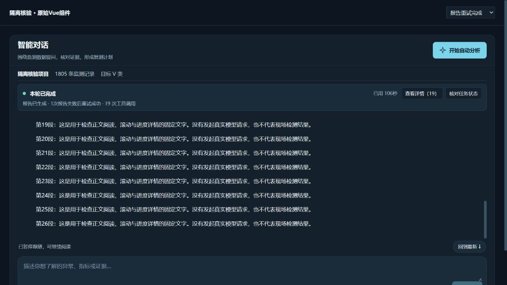
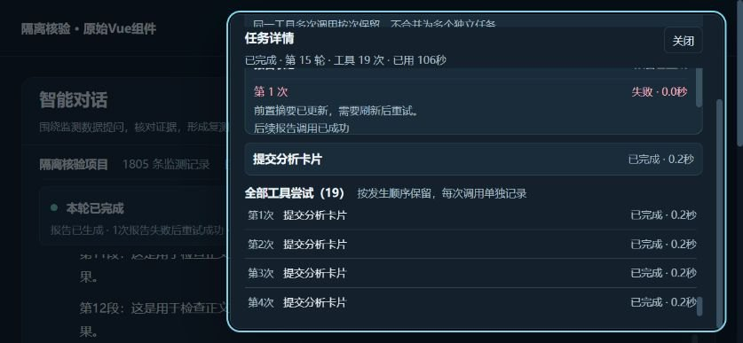

# 智能对话与报告可靠性修复验收

日期：2026-10-27。继DeepSeek前端布局改动与独立核验后，修复3个已复现缺陷，并补齐报告生成前的摘要刷新。

## 本次改动

1. **重试关系由后端确认。** AgentRun用输入参数、分析版本和结果版本区分逻辑操作，只将同一操作后续成功关联为恢复；对外只发送不透明operation_id、retry_of、recovered_by，不发送关联用的原始参数。前端同时核对恢复指向、操作标识、工具名与后续成功状态。不同坐标的查询不再互相消除失败。缺乏旧记录关联时保守保留失败。后端完成判定也不再因同名步骤覆盖而漏掉未恢复失败。
2. **截断记录不冒充完整事实。** 历史被截断且没有可核实报告状态时显示“报告状态暂无法核实”；后端单独保留本轮报告调用状态与次数，使报告步骤被后续100条窗口挤出后仍可核对。元数据含分析版本，前端拒绝错版本状态。
3. **矮屏详情能滚动。** 详情容器允许整体滚动，工具历史仍可单独滚动；标题关闭入口保持可达。报告尝试区也可键盘聚焦。保留DeepSeek的紧凑摘要、抽屉、焦点返回、阅读暂停与移动布局。
4. **报告前按需刷新摘要。** 自动分析已完成数据摘要、检测以及适用的视频步骤，而综合摘要因站点等结果更新失效时，后端显式执行一次真实综合摘要工具，再生成报告。不重跑全部检测、不绕过校验，也不伪造缺少的视频/检测状态。刷新步骤有SSE事件与实际证据记录。失败时仍阻止完整报告成功标记。
5. **参数与错误更明确。** generate_final_report保留summary字符串兼容字段，但不再强制模型提供实际未使用的摘要；事实继续由服务端重建。缺少必要步骤时返回结构化错误码和缺少项，界面只显示安全的固定步骤名称。

## 自动化验证

- 556项Python回归全部通过，字段、泛化、接口、密钥和HTTP类型样本导出检查通过。
- 346项前端测试全部通过，类型检查和生产构建通过。
- 相对DeepSeek交付后的代码新增10项Python、5项前端回归；另修正既有测试对“同名即恢复”的错误预期，并补齐组件隔离夹具的新接口。
- 覆盖站点更新后的最小摘要刷新、刷新失败阻止报告、真正缺少视频/检测不得补造、不同查询失败不被掩盖、明确重试关联、停止时关闭报告状态、历史截断与跨版本报告元数据。

## 真实调用与UI验证分开记录

**真实模型验证：** 从“111”已保存v10项目包恢复到独立Session，1805条原始走航记录、147帧；真实调用项目现有DeepSeek模型与工具。15次工具调用，0次工具失败，报告第1次调用成功，最终succeeded，耗时约150.81秒。日志实际出现“分析结果已更新，已重新取得综合摘要”，随后报告成功；该步骤不再依靠模型先报错后补跑。模型调用没有被替身替换，用户项目库未被此验收写入，完整回答留在本机验收目录。

**浏览器验证：** 用原始Vue组件和明确标注的固定情景做隔离UI检查，不把此页面说成真实模型输出。不同查询仍显示未恢复失败1；截断历史显示未知；标准桌面与手机保留正文阅读空间；844×390抽屉滚动后，历史底部约359px，处于抽屉底部374px以内，并能滚动到历史最后一步。移动端Tab焦点留在详情内，Escape关闭后归还入口。

**用户页面：** 5190服务恢复到保留的原项目存储，浏览器重新加载当前构建，项目111仍为1805条数据与147帧、保留已保存历史。服务启动前读取备份了项目v10；刷新前检查到输入草稿为空。隔离验收未覆盖写入111的报告。

## 边界

0次工具失败不等于现场检测准确率或因果结论已验证。原始样本中的视频区域/同步核实、缺少指标及物理配准等限制仍须按真实状态呈现。外部源回退与零匹配可能是正常业务缺口；本轮没有删除这些说明或将其改成污染源证明。未知恢复关系也不会为了让计数好看而消失。

本次保持既有模型选择和15轮上限；没有新增VLM、真实河道反演准确率或责任认定能力。后续任务队列按原状态推进。

机器可读记录：`validation/chat_repair_20261027.json`。

