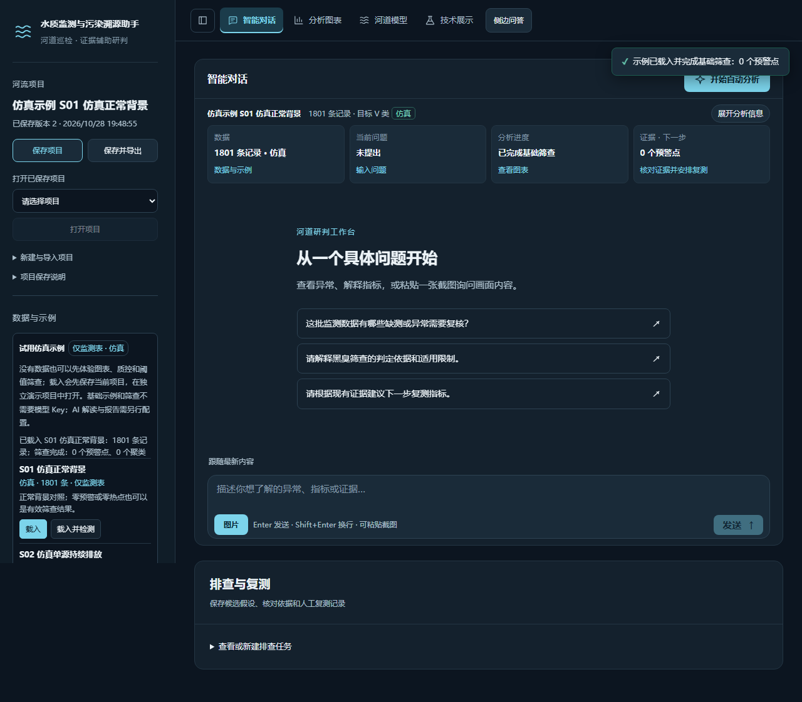
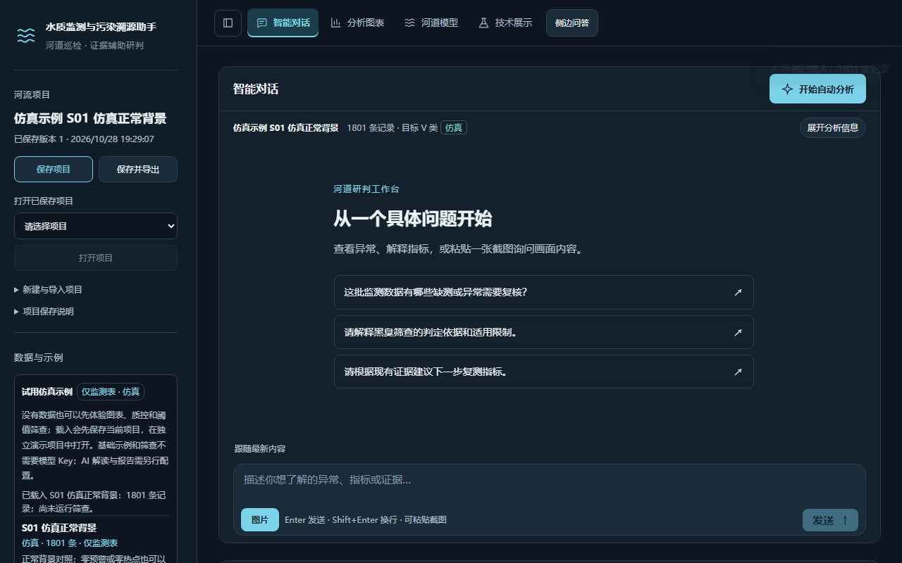
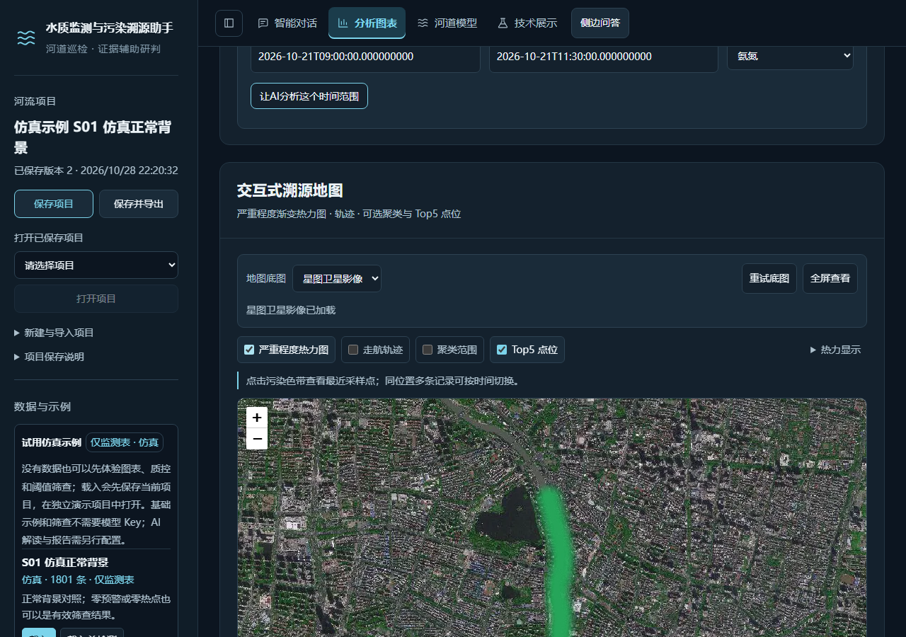
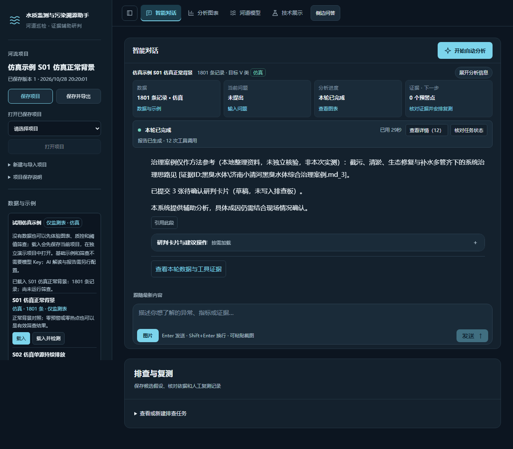
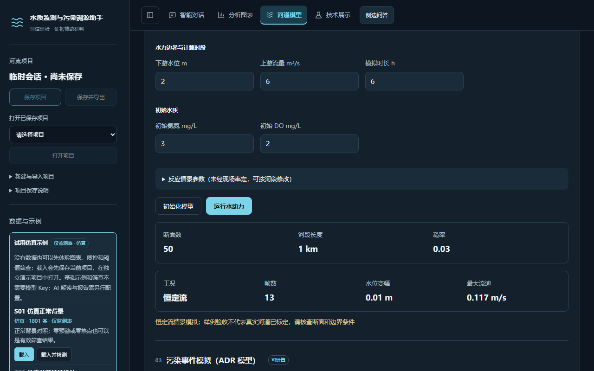
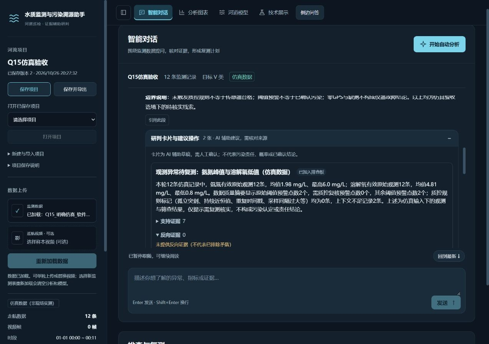
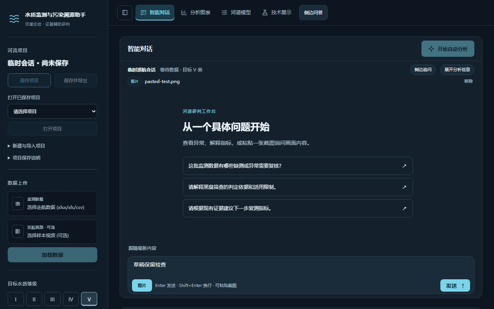

# 水质监测与污染溯源 AI Web 应用

## 系统说明文档

> 参赛方向：传智杯全国高校 AI Web 开发挑战赛（AI 数据分析与可视化 / RAG 知识问答系统）
> 文档版本：2026-10-30，源码 revision `284e51a`（以 `git log` 为准）
> 说明：本文只写代码与验收记录能够支持的能力；仿真、受控测试和真实模型小样不等于现场检测准确率，也不构成污染责任认定。

## 一、项目详情及使用方式

### 1.1 项目定位

面向河道走航监测场景，把上传的 CSV/Excel 监测表转换为可核对的水质趋势、异常点筛查、热点聚类、地图线索和排查建议。系统把确定性分析、DeepSeek 工具调用、RAG 治理案例检索、一维河道情景模型和图片视觉观察放在同一个 Web 工作台里，形成“数据 → 筛查 → 证据 → 解释 → 复测/排查”的闭环。

系统服务三类使用者：

- 参赛评委：用内置仿真示例在无 Key 情况下完成数据载入、筛查、图表、地图和手工河道情景；
- 水环境分析与巡测人员：上传自己的走航数据，核对质控、热点和证据，生成报告并保存项目；
- 二次开发者：阅读前后端源码、测试和验收记录，复现实验或替换数据源。

### 1.2 四个页面与主要能力

| 页面 | 主要能力 | 关键边界 |
| --- | --- | --- |
| 智能对话 `/chat` | SSE 流式 Agent、工具进度、停止/恢复、图片/视频帧上下文、四态研判工作台、结构化分析卡片、侧边追问、排查板 | 报告正文由服务端事实约束；模型负责解释，不负责编造观测 |
| 分析图表 `/charts` | 时序图、质控、内梅罗/黑臭筛查、空间聚类、轨迹地图、严重程度热力、Top5、视频线索与交叉印证 | 热点数量不是污染源数量；地图颜色不是采样密度 |
| 河道模型 `/river` | 通用河段参数、初始化断面、恒定流水动力、污染事件 ADR 模拟、沿程浓度、扩散播放 | 只支持一维恒定流情景；潮汐质量不守恒，不开放为正式结论 |
| 技术展示 `/tech` | RAG 检索与引用、国控站点、模型验证、能力矩阵、来源与限制说明 | 外部数据源按可用性独立降级，不把背景资料写成现场事实 |

### 1.3 使用方式

**环境**：Python 3.11+（本机以 Python 3.14.0 验证）；基础依赖安装 `requirements-ci.txt`；完整 RAG/Streamlit 依赖安装 `requirements-lock.txt`。前端已包含 `frontend/dist` 构建产物，评委不需要安装 Node。

**启动**：

```bat
python -m pip install -r requirements-ci.txt
python scripts/serve_web.py --port 5174
```

也可以双击 `打开系统.cmd` 或运行 `start_web.cmd`，浏览器打开 `http://127.0.0.1:5174/`。

**最短体验路径**：

1. 打开“项目与数据”，选择 S01—S06 之一，点“载入”或“载入并检测”；
2. 在“分析图表”查看趋势、筛查、聚类和地图；
3. 在“智能对话”输入问题，观察工具进度、证据卡和报告；
4. 需要情景分析时，在“河道模型”手工配置河段并运行恒定流；
5. 需要保存/迁移时，保存项目或导出 `.wqproj`。

**外部能力**：AI 对话/报告需要 `DEEPSEEK_API_KEY`；地图 POI、逆地理和卫星需要 `AMAP_KEY`、`CLOUD_TOKEN`；RAG 需要完整依赖、模型缓存和索引。缺少 Key、依赖或索引时，前端显示真实失败阶段，不伪造结果。

## 二、项目亮点

1. **完整业务闭环，而不是单点聊天**：数据载入、质控、双标准筛查、空间聚类、图表/地图、Agent 工具、RAG、报告、研判卡片、排查板和项目保存串联在四个页面内；用户可以从一个异常点回到原始记录，再生成复测建议。
2. **证据约束的 AI**：统计数字、检测结果、记录位置和引用片段由服务端按当前数据/项目版本读取；报告和卡片绑定证据包、工具快照、引用 ID 与版本；旧数据或旧报告会标记过期，不让模型自由补造。
3. **双标准与时空支持度**：GB3838-2002 的内梅罗指数用于连续排序，2015 年《城市黑臭水体整治工作指南》用于“是/否黑臭”点级判定；再叠加时间持续性与空间连续性。两者分工在界面和报告中有明确说明。
4. **前后端同源的工程化**：Vue 3 + Pinia 的请求/项目/版本保护，FastAPI 的会话中间件与 SSE，SQLite 项目索引 + 版本化 `.wqproj`，图片/视频附件按项目保存；会话通过 `X-Session-Id` 隔离，迟到响应不得写入新项目。
5. **多模态落在可核对的小步上**：Q18 支持单图/单视频帧和 2—8 帧短序列的**显式发送**；先预览、再提交，返回逐帧可见观察、直接变化和不确定说明；图片哈希、帧号、时间、视频/附件版本、模型和耗时随结果返回，不写报告、不凭图给浓度或责任。
6. **对边界诚实**：潮汐数值质量不守恒、断面几何是人工规则梯形、泛化依赖有限河流表、RAG 相似度不是结论概率；这些限制在页面、报告和验收文档中保留，而不是用演示话术掩盖。
7. **可复跑的验证体系**：Python 690 项、前端 383 项、22 份真实响应契约、`check_ci` 9/9；另有浏览器示例/可读性/性能验收、真实 DeepSeek 受控图片与报告流程记录。

## 三、AI 测试技术落地使用情况概述

本项目的 AI 落地不是“让模型自由写一段分析”，而是把模型放进受约束的工具与证据链中。对应的测试也按“正常路径 + 失败路径 + 版本/权限边界”组织：

| 验证对象 | 实际执行 | 结果与边界 |
| --- | --- | --- |
| Agent 工具循环 | DeepSeek Function Calling + SSE；自动分析 SOP；工具参数校验；停止/断流/重试；每轮工具结果全部返回后再追加图片 | 真实受控自动分析记录为 29 秒、12 次工具调用；失败重试仍可能因环境缺依赖保持“部分完成” |
| RAG 检索与回答 | 29 份治理资料、147 个片段；向量 + 词面融合、来源合并、可核对原文片段；固定 30 题集与 24 次真实模型回答 | 检索命中不等于治理效果；引用 ID 不证明正文每句话；无关问题/超时仍有未覆盖项 |
| 图片与视频帧观察 | 程序生成图、界面截图、受控视频帧、连续帧和 Q18 单图/2—8 帧序列；显式发送、预览、来源/版本/哈希核对 | 真实受控单图 1.87 秒；两帧序列 3.63 秒；不是现场污染识别准确率，原生视频未接入 |
| 失败与降级 | 缺 Key、缺依赖、缺索引、外部服务失败、模型超时、空结果、静态序列、人工排除帧、旧版本/跨项目/切换项目 | 分别显示阶段和可操作提示；不把失败写成成功，不把旧结果标成当前 |
| 回归与门禁 | `python -m unittest discover -s tests -p "test_*.py"`；`npm --prefix frontend run check`；`scripts/check_ci.py`；真实 TestClient 契约导出 | 当前 Python 690 项、前端 383 项、契约 22 份、密钥检查 9/9；测试以离线和受控数据为主，不替代现场评测 |

“AI 测试技术”的边界也写清楚：本项目没有把自动生成测试、自动判定模型回答正确率作为产品能力；AI 主要用于**分析辅助、工具编排、RAG 解释和视觉观察**，测试由规则回归、受控模型替身、真实模型小样和浏览器验收共同完成。

## 四、项目涉及的关键技术

| 层次 | 技术 | 在本项目中的作用 |
| --- | --- | --- |
| 前端 | Vue 3、Vite、Pinia、Vue Router、ECharts、Leaflet | 四页应用、图表/地图前端渲染、SSE 事件解码、请求与项目版本保护、响应式/可读性 |
| 后端 | FastAPI、Starlette 中间件、SSE、Pydantic | 会话隔离（`X-Session-Id`）、上传/分析/项目/图表/Agent/RAG/媒体接口、参数校验和统一错误 |
| 数据 | pandas、NumPy、OpenCV、Excel/CSV 加载器 | 列名归一化、时间解析、观测/插值掩码、DO=0 保留、视频抽帧、图片解码与规范化 |
| 检测 | 内梅罗指数、GB3838-2002、2015 黑臭指南、DBSCAN、球面距离/时间门限 | 点级筛查、双标准判定、时空增强排序、热点聚类；缺 GPS 不参与空间聚类 |
| 数学 | 一维 Saint-Venant、Preissmann、ADR 对流-扩散-反应、Fischer 离散 | 恒定流情景、污染事件沿程浓度、扩散播放；潮汐质量不守恒是已知缺陷 |
| RAG | ChromaDB、text2vec-base-chinese、向量/词面融合、引用片段 | 治理案例检索、来源合并、可核对引用；相似度不是概率 |
| Agent | DeepSeek Function Calling、SSE、工具白名单、证据包 | 自动分析、自由问答、项目数据只读读取、停止/恢复、失败收敛 |
| 视觉 | 图片解码/规范化、SHA-256、data URL、多帧序列、严格 JSON | Q18 单图/单帧/2—8 帧观察；显式发送、来源/版本绑定、不写报告 |
| 工程 | SQLite 项目索引、版本化 `.wqproj`、schema 4、媒体附件、项目发布回滚、交付打包 | 项目保存/恢复/导入导出、失败回滚、无密钥交付、可复现验收 |

## 五、项目相关图片/照片

以下为已有验收截图，均来自本机受控测试或真实服务页面；截图不代表现场实测。



*图 1　协同研判工作台（S01 V2 示例载入后）*



*图 2　V2 卫星水面定线示例与走航轨迹*



*图 3　分析图表与筛查结果*


*图 4　地图热力、轨迹与采样点*



*图 5　RAG 成功路径与报告证据（完整依赖环境）*



*图 6　河道模型分步引导与恒定流情景*



*图 7　结构化分析卡片与证据来源*



*图 8　图片上下文、来源卡与显式发送入口*

## 六、发表或获奖情况

截至 2026-10-30，本仓库及现有验收记录中**没有记录任何公开发表或获奖信息**。本作品的前身《水质监测溯源助手》曾用于作者此前参加的苗圃杯，但本仓库未保存该赛事的获奖结果或证书信息，因此本文不声称任何未核实的奖项。

如团队实际获得过赛事奖项、软件著作权、论文或公开演示，请在提交前补充：赛事/期刊名称、作品名称、时间、奖项等级/录用状态、证书或链接。没有可核实材料时，建议保留本节的“未记录”表述。

## 七、在其他项目基础上的优化说明

本作品的 **Python 分析内核**（`water_quality_mcp/`、`river_model/`、`knowledge_base/`、部分 `scripts/` 与旧 Streamlit `app.py`）沿用作者此前参加苗圃杯的作品《水质监测溯源助手》，由作者本人独立开发；来源在 README 和首次提交中明确标注。本次参赛的增量工作主要是 Web 化、工程化和证据链重构：

| 方向 | 原项目/旧形态 | 本次优化 |
| --- | --- | --- |
| 交互层 | Streamlit 单页 + 同步阻塞 | 从零重写 Vue 3 四页应用；FastAPI + SSE；请求/项目/版本保护；桌面/窄屏可读性 |
| 会话与项目 | `st.session_state` 进程内状态 | `X-Session-Id` 会话中间件；SQLite 项目索引；版本化 `.wqproj`；保存/恢复/导入导出/失败回滚 |
| 数据语义 | 插值、清洗与筛选口径分散 | 统一加载器；原始观测/插值标记；DO=0 保留；坐标观测掩码；旧项目过期重分析 |
| 检测与地图 | 点级检测与静态图为主 | 双标准筛查、DBSCAN 时空聚类、前端 ECharts/Leaflet、热力/轨迹/Top5、缺 GPS 不参与空间定位 |
| AI 能力 | 原 Streamlit 工具/报告 | 工具循环、自动分析 SOP、进度/停止/恢复、RAG 融合检索、报告证据包、研判卡片、排查板、侧边追问 |
| 视觉能力 | 原视频质量线索 | Q18 单图/单帧/2—8 帧结构化观察；显式发送、预览、来源/版本/哈希、静态序列和失败门禁 |
| 交付与验证 | 依赖本机环境的手工演示 | 内置 V2 仿真示例、干净 CI、契约导出、浏览器验收、交付 ZIP/无 Key 副本验证；明确未验证项 |

优化不改变原作品的来源事实，也不把复用的内核写成“全部新开发”。当前仍保留的边界包括：潮汐数值质量不守恒、断面几何为人工规则梯形、泛化依赖有限河流表、RAG 相似度不是结论概率、Q18 时间偏移/传感器冲突与非连续选帧未接、原生视频未接入。这些均在 `docs/` 的验收记录中保留。

## 附录：复现入口

- 快速启动与评委说明：`评委使用说明.txt`、`打开系统.cmd`
- 交付与安装：`docs/交付说明_20261028.md`、`docs/Windows安装与运行环境验证_20261028.md`
- 任务与状态：`docs/任务队列.md`
- 项目交接：`docs/项目情况汇报与Codex交接_20261028.md`
- Q18 视觉证据：`docs/Q18视觉证据接入阶段A_20261029.md`、`docs/Q18视觉证据接入阶段B_20261029.md`
- 验证命令：

```bash
python -m unittest discover -s tests -p "test_*.py"
npm --prefix frontend run check
python scripts/check_ci.py
```
