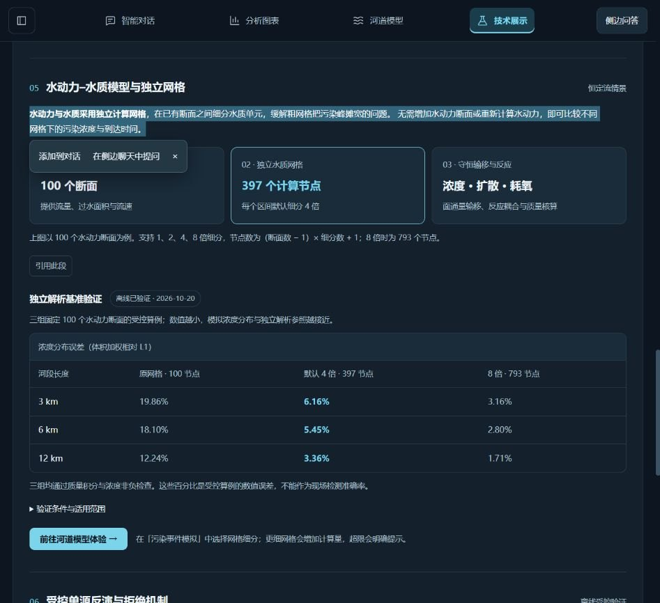
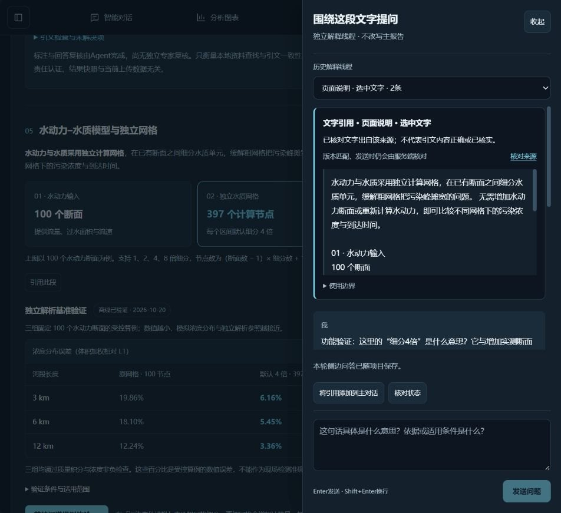

# 网格技术说明划词与侧边解释修复

2026-10-27。目标为技术展示的独立网格介绍、流程卡及节点公式说明。此前这部分没有`QuoteText`可引用区域，也没有服务端帮助来源编号，因此鼠标能选择文字却不弹引用菜单。现在新增`grid_help`来源、对应原文与“引用此段”备用按钮，沿用主聊天和侧边线程的显式发送、来源、版本及草稿保护。

原文仅覆盖上述明确区域；原理基准表、条件折叠和其他未注册说明不因此自动成为可引用区域，不宣称任意整页均已支持。服务端继续核对原文，不接收虚构说明；新增前端渲染契约，页面文字与`backend/grid_help.txt`不一致时测试失败。没有改动网格、反演或水质检测算法。

真实浏览器验证：鼠标拖选介绍弹出“添加到对话 / 在侧边聊天中提问”；前者进入主聊天显示待解释引用，未发送主问题，测试后移除测试引用并恢复原来的空草稿。选择流程卡的“每个区间默认细分4倍”可打开侧边；整段备用按钮也能准备引用。

实际发送侧边问题时另发现`resolve_api_key()`遗漏必需参数，导致解释初始化失败。已改为显式解析DeepSeek密钥；新增使用真实解析函数签名的受控测试，同时对其他测试的该函数替身启用autospec，避免相同错误被宽松模拟掩盖。再次真实发送以“功能验证”标注的问题，DeepSeek返回关于4倍细分和新增实测断面的解释，页面显示本轮问答已随项目保存；主报告保持独立。一次失败尝试未调用模型，最终成功尝试实际HTTP为200。

验证：542项Python、315项前端、类型检查和生产构建通过；既有字段、泛化、接口、密钥扫描及HTTP类型样本门禁通过。Python受控测试只证明协议与隔离；上述浏览器最终问题是实际在线模型调用，不能代替现场准确率评测。

本轮全门禁还发现上次无视频验收JSON的45个32位随机步骤编号触发密钥特征扫描。真实.env密钥值比对没有命中；这些编号属于临时元数据。已从公开验收JSON移除，保留步骤名称、状态和耗时，原始记录仍在本机work目录；没有放宽扫描规则、删除Git历史或冒称这批编号是API密钥。最终密钥门禁9项通过。

重启前“111”已保存为v4并导出备份；1805条监测记录、147帧及历史报告保留。新增功能验证问答已清楚标注，作为侧边独立线程保留。

