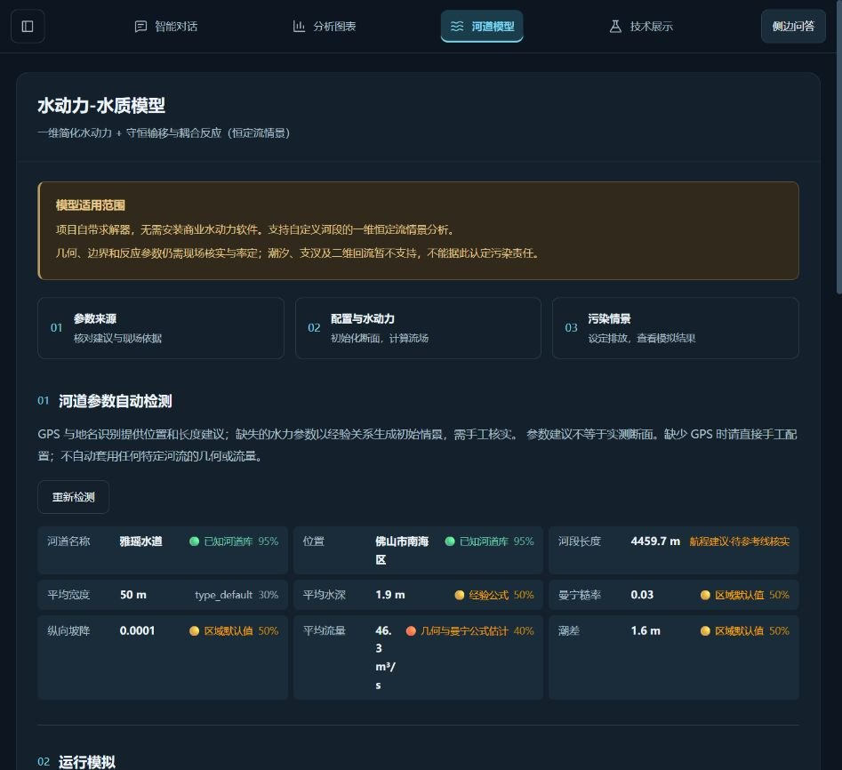
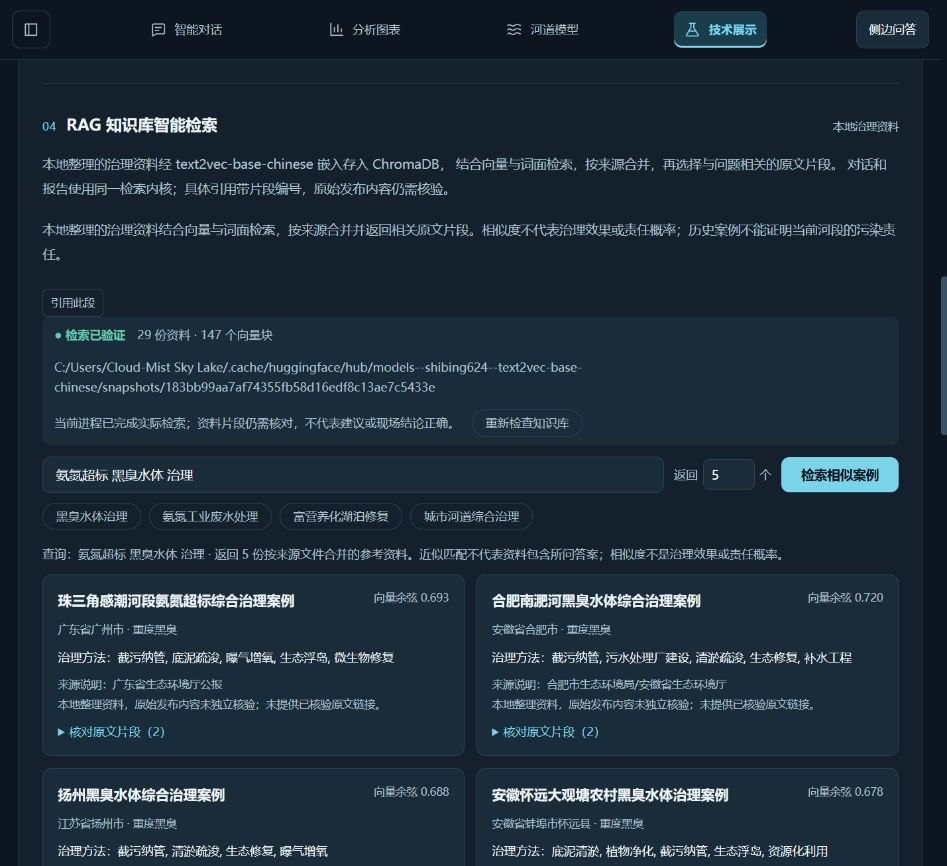

# 页面导航、工具状态与运行环境修复验收

日期：2026-10-27。实际修改与5190运行源码：`E:/E-Desktop/传智杯-备赛`。用户另提到的`传智杯-deep seek`副本本轮未能稳定读取，本记录不声称对那个副本完成测试。六份仿真文件取自当前运行项目的`仿真数据`目录。

## 原因与修复

1. 真实浏览器日志出现旧`RiverView`/`TechView`动态模块加载失败。构建替换了磁盘产物，旧页面仍引用旧散列文件。服务现在在启动时只读固定的index/assets快照，运行中重建不会删掉旧页面需要的资源；新版本等下次启动生效。HTML每次重新校验，散列资源采用不可变缓存与ETag；仅暴露构建资源，缺失资源及敏感路径保持404。重启/换版本导致客户端仍旧时，路由错误显示固定提示，保留当前页；用户先保存/复制草稿后显式刷新，忙碌期间禁止该操作，没有自动刷新循环。
2. 我启动的5190隔离验收环境仅带CI核心依赖，缺少ChromaDB/sentence-transformers，且索引指向空测试目录，导致报告内部案例检索降级。已复用本机完整依赖、缓存嵌入模型和索引的隔离副本恢复真实检索。原始`.rag_index`未被本轮检索探测改写；本次未下载大模型或删除用户文件。页面现在显示实际检索已验证，真实查询返回5份带原文片段的参考资料。
3. 无视频不应当作视频检测失败：工具若被调用，返回`skipped`且说明缺少媒体；仿真数据有意跳过真实企业/国控归因查询。政府实时接口降级为站点目录与知识库不可用是不同情况，不能归结为同一种算法失败。新增逐项固定原因提示，区分失败、跳过、无实时值和报告无可用案例；不回显工具原始异常、路径、凭据或模型内部推理。原有必需步骤失败仍不会被标记为整轮成功。
4. 原历史列表固定在顶部，容易给人“停住”印象。新增最新操作/耗时/结果计数与独立最新步骤，历史默认跟随；用户上滚或选字时暂停跟随，可手动回到最新；完成时收起普通历史，失败、跳过或带提示的记录保持可查。停止已完成后不再显示仍锁定。截图蓝色虚线和编号属于浏览器批注选区，不是页面中的可拖动光标。

## 数据保护与验证

修复重启前将“111”保存为v2并导出项目包，另留本机副本；恢复后仍有1805条原样例记录、147帧和已保存报告。没有用QA数据覆盖用户会话。测试使用独立会话、项目存储和索引副本；项目备份不入Git。

- 539项Python回归通过；既有字段、泛化、后端接口、密钥扫描和HTTP类型样本导出门禁通过。
- 308项前端测试、类型检查（含1个已迁移SFC脚本严格检查）与生产构建通过；最后固定提示文字微调后18项路由测试及构建再次通过。不是全站TypeScript迁移完成声明。
- 六份Excel各1801行、0视频帧，修复后的真实DeepSeek Agent自动流程全部`succeeded`，必需步骤已完成且正文未截断。另对每份数据直调四种不适用工具验证`ok=true/skipped=true`；Agent可直接省略这些不适用工具，不要求为了计数重复调用。日志见`validation/no_video_sdk_matrix_20261027.json`。只验证软件流程，不是检测/反演准确率证明。
- 真实浏览器验证River、Tech直接切换及原数据恢复；在服务运行中再次构建前端，旧页面仍能打开此前未加载的Charts页；Tech实际检索返回原文片段。截图见下方。这轮未新增窄屏浏览器性能画像，Q17整体流畅度验收仍待完成，不能称所有场景均无卡顿。

## 独立协作与剩余范围

三路DeepSeek API分别提供路由恢复、进度组件和无视频流程审查草稿，只写候选文件；主代理核对后才应用，并修正忙碌状态恢复、查询/哈希保留、阅读/选字保护、停止提示与测试宿主等问题。Pro思考审查因长度上限无最终结果，未计作通过；另一次Pro直接审查提出三项意见，主代理逐项核查后未采用：引用元数据已JSON解析、RLock的with会在异常时释放、导航没有自动重试循环。机器记录保留判断依据，不把审查模型输出直接当事实。

图像API已完成生成单图和双帧的小型独立探测，业务接入仍未实现。见[Q18视觉证据接入方案](Q18图像与视频视觉证据接入方案.md)。真实MP4/音轨理解、河道视觉识别准确率、现场校准、Q16工作台及Q17整体性能验收仍未完成。
